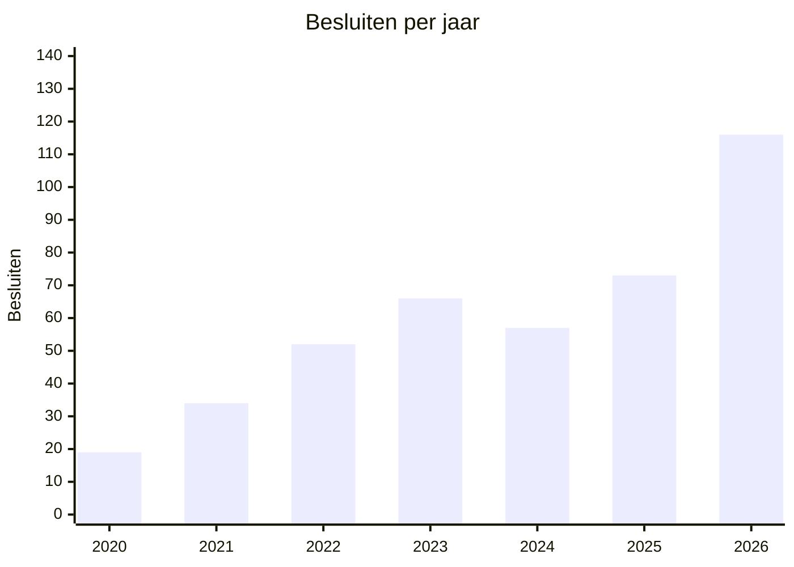

# Businesscase

## Doorzoekbare UWV Woo-publicaties

Versie 1.0 · 2 november 2026  
De cijfers hieronder zijn geteld op de extracten in deze repository. Bedragen zijn potentieel, geen omzet. De site vraagt geen geld. De opbrengst is uitgespaarde zoektijd, en in een kleiner scenario een vermeden herhaalde Woo-aanvraag.

## 1. Vraag

UWV maakt Woo- en oudere Wob-besluiten openbaar als PDF. Het aantal openbaar gemaakte besluiten stijgt. Zonder zoekindex groeit ook de tijd die een journalist, advocaat, onderzoeker of behandelaar kwijt is om te zien of een onderwerp al eerder is beslist.

Een publicatie in deze corpus is het openbaar gemaakte besluit op een aanvraag, inclusief bijlagen. Het is niet de volledige interne instroom van UWV. Aanvragen die niet zijn gepubliceerd, nog lopen, of alleen persoonsgegevens betreffen, zitten hier niet in. De reeks is wel de zichtbare, groeiende stapel waar iemand nu doorheen moet.

## 2. Aantal aanvragen dat openbaar is gemaakt

Stand op 2 november 2026: 418 publicaties, 1.744 PDF’s, 33.597 pagina’s, ongeveer 18,5 miljoen woorden. Daarvan is 362 een Woo-publicatie en 56 een Wob-publicatie. Bij 375 PDF’s (21,5%) was OCR nodig. Een publicatie bevat gemiddeld 4,2 documenten. De mediaan is 8 pagina’s. Een klein aantal grote dossiers trekt het gemiddelde naar 80 pagina’s.

2026 telt alleen januari tot en met oktober. In die tien maanden staan er al meer besluiten openbaar dan in heel 2025.

| Jaar | Besluiten | Documenten | Pagina's |
| --- | --- | --- | --- |
| 2020 | 19 | 42 | 450 |
| 2021 | 34 | 72 | 762 |
| 2022 | 52 | 201 | 4.638 |
| 2023 | 66 | 202 | 4.343 |
| 2024 | 57 | 257 | 4.520 |
| 2025 | 73 | 400 | 7.760 |
| 2026 t/m oktober | 116 | 487 | 9.837 |

Zelfde periode, januari tot en met oktober:

| Periode | Besluiten | Documenten | Pagina's |
| --- | --- | --- | --- |
| 2024 | 49 | 217 | 4.259 |
| 2025 | 60 | 321 | 7.190 |
| 2026 | 116 | 487 | 9.837 |
| 2025 t.o.v. 2024 | +22% | +48% | +69% |
| 2026 t.o.v. 2025 | +93% | +52% | +37% |

Van 2020 tot en met 2025 groeide het aantal besluiten met 31% per jaar (van 19 naar 73). Van 2021 tot en met 2025 was dat 21% per jaar. 2024 was een dip. De sprong in 2026 is groter dan die lange termijn, en zit vooral in de tweede helft: juli 24, augustus 29, september 10, oktober 7. November en december zijn nog niet gepubliceerd in deze corpus.

Een nuchtere afronding van 2026: november en december op het tempo van september en oktober, ongeveer 8 à 9 besluiten per maand. Dan eindigt 2026 op circa 133. De vlakke doorrekening van het huidige maangemiddelde (116 × 12 / 10) komt op 139. Verder reken ik met **130 besluiten in 2026**.

## 3. Wat de groei doet met de zoektijd

Op uwv.nl zijn de besluiten een lijst met PDF-links. De tekst van een scan is daar niet doorzoekbaar. Iemand die wil weten of UWV al iets openbaar maakte over een risicoscan, een loonsanctie of een bezwaar, opent dossiers tot het antwoord er is of tot duidelijk is dat het er niet in staat.

Die laatste uitkomst wordt duurder naarmate de stapel groeit. In de eerste tien maanden van 2026 kwamen er 56 besluiten bij ten opzichte van dezelfde maanden in 2025, en bijna 2.650 pagina’s. Elk nieuw dossier is een extra plek waar het antwoord kan staan.

## 4. Potentieel per jaar

De site levert geen facturen op. De baat is tijd van mensen die de stapel anders handmatig doorzoeken. Drie aannames, alle drie expliciet:

- Een inhoudelijke zoekvraag scheelt 20 minuten. Voorzichtig is dat 10 minuten, als iemand alleen de juiste PDF zoekt en de bron daarna zelf leest. Ruim is dat 35 minuten, als ook het wegstrepen van niet-relevante dossiers meetelt. OCR blijft een hulpmiddel. De bron-PDF blijft de controle.
- Een werkjaar heeft 46 zoekweken.
- Een uur van een journalist, jurist, onderzoeker of behandelaar kost €70 integraal. Dat is een rekenprijs, geen tarief van UWV. Bij €45 ligt de baat 36% lager. Bij €120 ligt hij 71% hoger.

| Scenario | Gebruik | Zoekvragen per jaar | Uren | Baat bij €70 |
| --- | --- | --- | --- | --- |
| Laag | 8 mensen, 1 zoekvraag per week | 368 | 123 | € 8.600 |
| Midden | 40 mensen, 1 zoekvraag per week | 1.840 | 613 | € 42.900 |
| Hoog | 120 mensen, 1,5 zoekvraag per week | 8.280 | 2.760 | € 193.200 |

Gevoeligheid van het middenscenario, zelfde gebruik, ander aantal minuten:

| Tijdwinst per zoekvraag | Uren | Baat bij €70 |
| --- | --- | --- |
| 10 minuten | 307 | € 21.500 |
| 20 minuten | 613 | € 42.900 |
| 35 minuten | 1.073 | € 75.100 |

Er is geen bezoekmeting in deze repository. Het middenscenario is daarom de rekenbasis, niet een gemeten gebruik. Het past bij een kleine vakgroep die de publicaties structureel volgt: redacties, rechtshulp, belangenbehartigers en mensen die de besluiten inhoudelijk moeten kennen.

## 5. Extra baat: een aanvraag die niet nog eens gedaan wordt

Een tweede, smallere baat ontstaat als iemand in de index ziet dat het stuk er al is en geen nieuwe Woo-aanvraag indient. Een gepubliceerd besluit is het resultaat van behandelwerk. Als dat behandelwerk voor een vergelijkbare vervolgaanvraag 6 uur kost, is de rekenwaarde €420 per vermeden aanvraag (6 × €70).

| Vermeden aanvragen per jaar | Baat bij €70 |
| --- | --- |
| 10 | € 4.200 |
| 25 | € 10.500 |
| 50 | € 21.000 |

Dit stapelt alleen op als de site een aanvraag echt voorkomt. Het is geen automatische opbrengst van de 130 besluiten. Tien vermeden aanvragen is een voorzichtige toeslag op het middenscenario. Vijftig is alleen realistisch als de index een vaste eerste stap wordt vóór een nieuwe aanvraag.

## 6. Kosten

De crawl en de site draaien op een openbare GitHub-repository en GitHub Pages. Licentiekosten zijn €0. De variabele kost is beheer: controle of de dagelijkse run liep, en of een OCR-fout de vindbaarheid raakt.

| Post | Aanname | Per jaar |
| --- | --- | --- |
| Hosting en Actions | openbare repository | € 0 |
| Beheer | 3 uur per maand × €70 | € 2.520 |

Het bouwen van de pipeline en de site is al gebeurd. Die eenmalige inspanning zet ik niet opnieuw als kost in deze jaarberekening.

## 7. Drie jaar, middenscenario

Het aantal besluiten groeide langjarig met ongeveer 20% per jaar. Ik laat het gebruik in dit scenario met hetzelfde tempo meegroeien, omdat een grotere stapel vaker een reden is om te zoeken. De beheerlast blijft vlak.

| Jaar | Besluiten, richting | Zoekbaat | Vermeden aanvragen, 10 stuks | Beheer | Netto |
| --- | --- | --- | --- | --- | --- |
| 2026 | circa 130 | € 42.900 | € 4.200 | € 2.520 | € 44.600 |
| 2027 | circa 156 | € 51.500 | € 4.200 | € 2.520 | € 53.200 |
| 2028 | circa 187 | € 61.800 | € 4.200 | € 2.520 | € 63.500 |
| Totaal | | € 156.200 | € 12.600 | € 7.560 | € 161.200 |

2027 is 130 × 1,20, afgerond. 2028 is dat resultaat nog eens × 1,20. De zoekbaat groeit in dezelfde verhouding door, vanaf €42.900. De vermeden aanvragen houd ik vlak op 10 per jaar, omdat die baat onzekerder is dan de zoektijd.

Komt de sprong van 2026 niet terug en blijft het aantal op 130, dan blijft de zoekbaat rond €42.900 per jaar staan. Drie jaar netto, inclusief dezelfde 10 vermeden aanvragen en het beheer: ongeveer €134.000. Ook het lage gebruiksscenario blijft positief: €8.600 zoekbaat tegen €2.520 beheer, circa €6.100 per jaar, vóór de vermeden aanvragen.

## 8. Conclusie

In de eerste tien maanden van 2026 publiceerde UWV 116 Woo- en Wob-besluiten, tegen 60 in dezelfde maanden van 2025. Dat is bijna een verdubbeling. De stapel telt inmiddels 1.744 documenten.

De zoeksite verdient zich terug zodra een kleine vaste groep hem gebruikt. Acht mensen, één zoekvraag per week, 20 minuten tijdwinst en €70 per uur leveren ongeveer €8.600 per jaar op, tegen €2.520 beheer. Een vakgroep van veertig mensen komt op ongeveer €42.900 zoekbaat per jaar. Over drie jaar, met 20% meer gebruik per jaar en tien vermeden herhaalaanvragen, is het potentieel ongeveer €161.000 aan uitgespaarde tijd.

Dat is geen kasopbrengst. Het is tijd die niet meer in het openen van PDF’s gaat zitten, terwijl het aantal aanvragen dat openbaar wordt gemaakt blijft stijgen.
