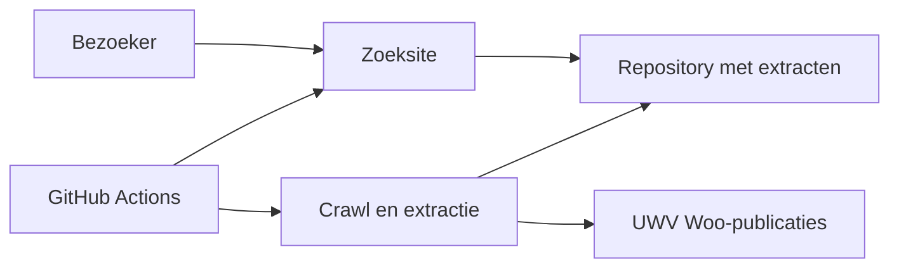
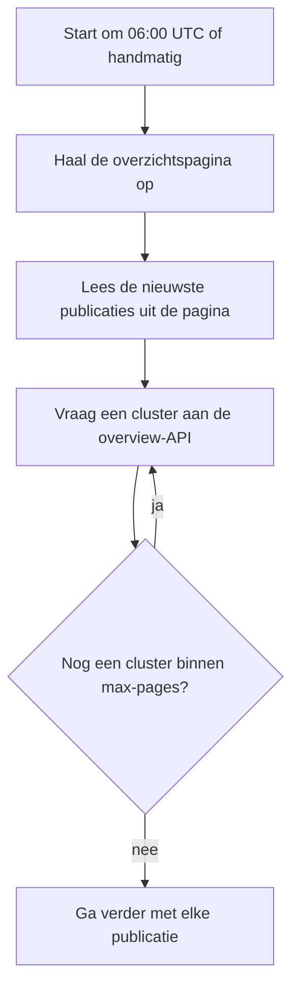
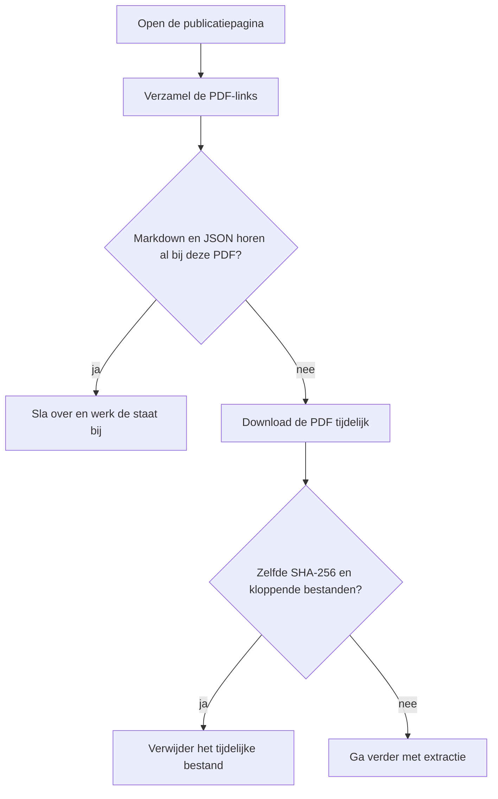
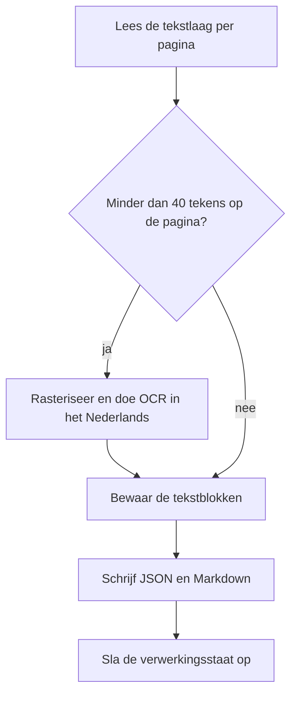
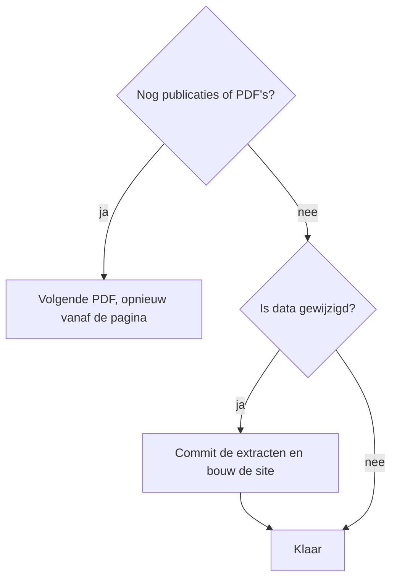
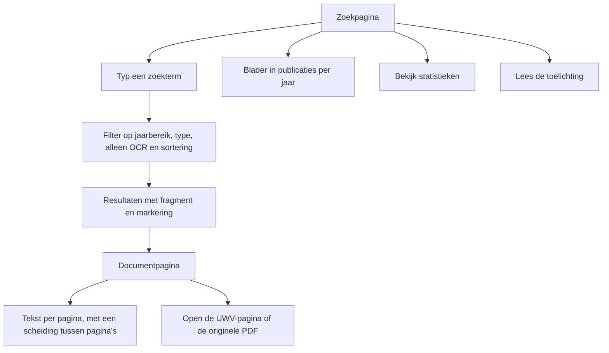

# Functioneel ontwerp

## UWV Woo-publicaties, full-text search

Versie 1.0 · 2 november 2026  
Beschrijft het systeem zoals het in deze repository is gebouwd.

## 1. Doel

De site maakt openbaar gemaakte Woo-publicaties van UWV doorzoekbaar. Een dagelijkse pipeline haalt nieuwe publicaties op, extraheert de tekst uit de PDF’s en publiceert een statische zoeksite. De originele PDF blijft op uwv.nl. De repository bewaart alleen tekstextracten, metadata en de zoeksite.

OCR kan fouten bevatten. De site verwijst daarom altijd terug naar de bronpagina en de originele PDF.

## 2. Scope

Binnen scope:

- ophalen van het publicatieoverzicht en de publicatiepagina’s
- downloaden van gekoppelde PDF’s, alleen tijdelijk tijdens verwerking
- tekstextractie, met OCR als een pagina te weinig tekst bevat
- opslag als Markdown en JSON, plus een verwerkingsstaat
- statische zoeksite met documentpagina’s, publicatielijst en statistieken
- publicatie via GitHub Actions en GitHub Pages

Buiten scope:

- bewaren van de PDF-bestanden in de repository
- inloggen, persoonsgegevens of een redactieomgeving
- wijzigen of beoordelen van de UWV-documenten
- juridische duiding van de inhoud

## 3. Actoren

| Actor | Rol |
| --- | --- |
| Bezoeker | Zoekt, filtert en leest extracten. Opent de bron op uwv.nl. |
| Onderhouder | Start een handmatige crawl of sitebouw, bijvoorbeeld voor een backfill. |
| GitHub Actions | Start de dagelijkse crawl en publiceert de site als `data/` wijzigt. |
| UWV-website | Bron van overzicht, publicatiepagina’s en PDF’s. |

## 4. Context

## 5. Dagelijks verwerkingsproces

Standaard wordt alleen de eerste overzichtspagina verwerkt. Een handmatige run kan meer pagina’s vragen via `max-pages`, of het aantal publicaties begrenzen via `limit`.

De nieuwste publicaties komen uit de HTML van de overzichtspagina (`first-results`). Daarna vult de overview-API aanvullende clusters aan. Dat voorkomt dat een verouderde API-cache de nieuwste besluiten weglaat.

### Overzicht ophalen

### Per publicatie en PDF

### Extractie

### Publicatie

Een mislukte publicatie of PDF stopt de run niet. De fout wordt gelogd en de volgende PDF gaat door. Het tijdelijke PDF-bestand wordt daarna verwijderd.

## 6. Functies voor de bezoeker

De zoekindex draait in de browser. Er is geen zoekserver. Filters en sortering werken op de geladen index: relevantie, nieuwste eerst of oudste eerst.

## 7. Functionele eisen

| Id | Eis |
| --- | --- |
| F01 | De crawl haalt standaard de eerste overzichtspagina op en kan bij een handmatige run meer pagina’s ophalen. |
| F02 | Publicaties worden ontdubbeld op URL. |
| F03 | Van elke publicatiepagina worden de PDF-links gelezen. |
| F04 | Een PDF die al als Markdown en JSON bij dezelfde URL hoort, wordt niet opnieuw gedownload. |
| F05 | Een PDF met een andere SHA-256 wordt opnieuw verwerkt. |
| F06 | Elke pagina gebruikt de tekstlaag. Bevat die minder dan 40 tekens, dan wordt die pagina met OCR gelezen. |
| F07 | Het JSON-bestand bevat metadata en geordende blokken met type, pagina, positie, tekst en bron (`text` of `ocr`). |
| F08 | Het Markdown-bestand bevat dezelfde metadata, de tekst en links naar de publicatiepagina en de PDF. |
| F09 | PDF-bestanden zelf worden niet in de repository opgeslagen. |
| F10 | De site toont dat OCR onbetrouwbaar kan zijn en linkt naar de bron. |
| F11 | De bezoeker kan full-text zoeken over alle extracten. |
| F12 | De bezoeker kan filteren op jaar, publicatietype en OCR-gebruik, en de sortering kiezen. |
| F13 | Een documentpagina toont de geëxtraheerde tekst met een scheiding tussen pagina’s. |
| F14 | De site biedt een publicatielijst per jaar, een statistiekenpagina en een pagina met toelichting. |
| F15 | De site wordt opnieuw gepubliceerd wanneer de extracten of de sitebron wijzigen. |
| F16 | De interne dashboardpagina wordt uitgesloten voor crawlers. |

## 8. Informatieobjecten

| Object | Inhoud | Bewaarplaats |
| --- | --- | --- |
| Publicatie | titel, datum, type, URL | afgeleid tijdens de crawl |
| PDF-kandidaat | PDF-URL, label, publicatie | alleen tijdens de run |
| Extract | metadata plus tekstblokken | `data/<publicatie>/<document>.json` en `.md` |
| Verwerkingsstaat | PDF-URL, SHA-256, paden, ophaalmoment | `data/state.json` |
| Zoekdocument | titel, tekst, filters, jaar | zoekindex in de gebouwde site |
| Documentpagina | leesbare weergave van één extract | statische HTML |
