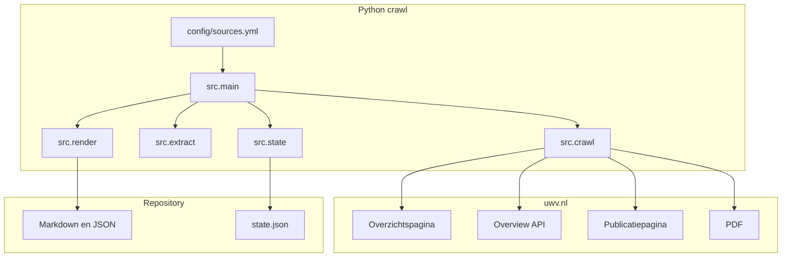
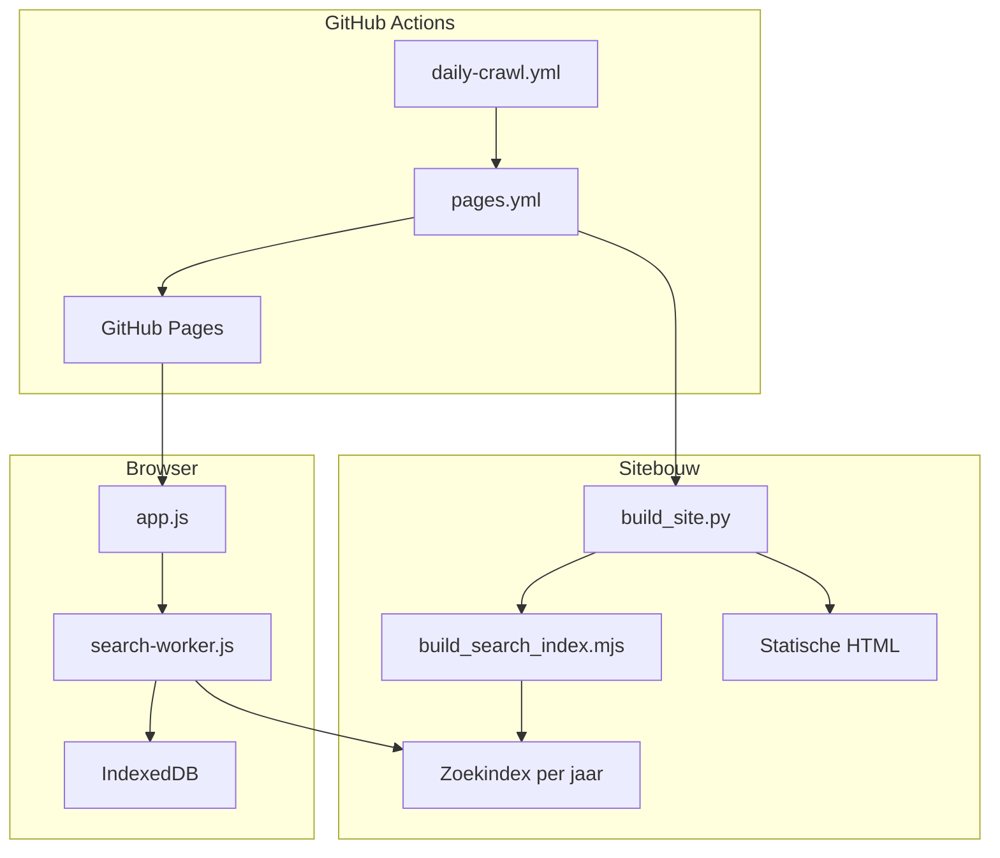
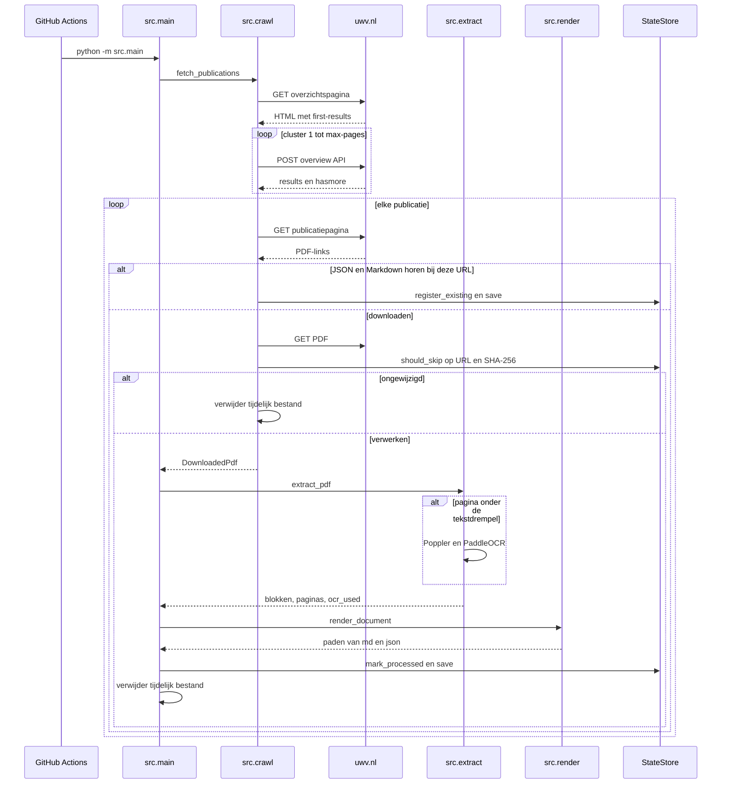
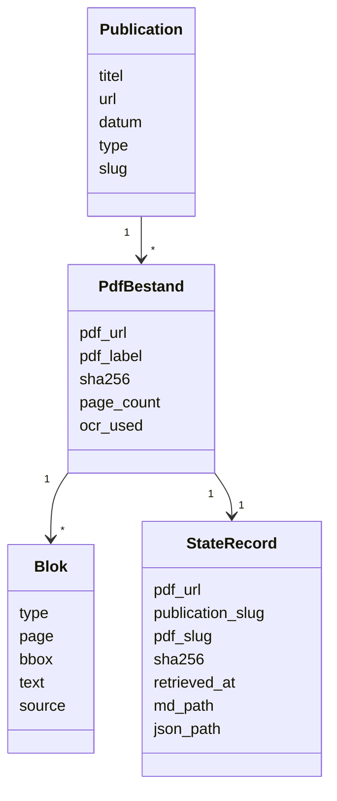
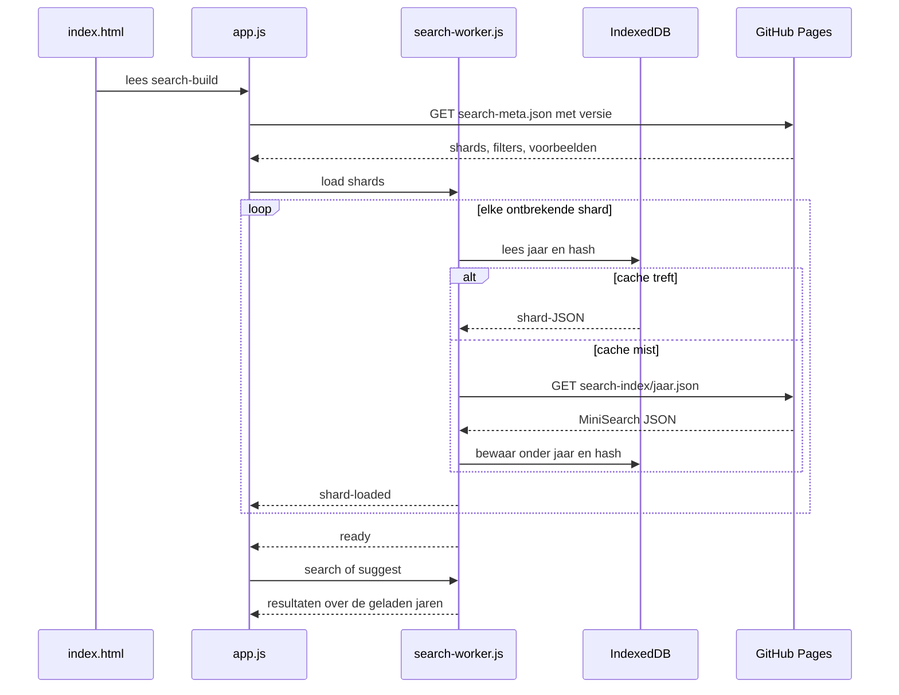
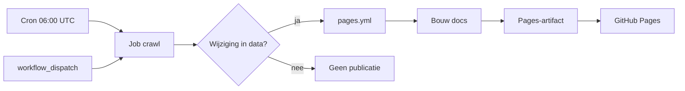

# Technisch ontwerp

## UWV Woo-publicaties, full-text search

Versie 1.0 · 2 november 2026  
Beschrijft de implementatie in deze repository.

## 1. Componenten

De crawl is een Python-pakket onder `src/`. De sitebouw staat in `scripts/build_site.py` en schrijft statische bestanden naar `docs/`. GitHub Actions voert beide stappen uit. De browser zoekt lokaal met MiniSearch in een web worker.

### Crawl en opslag

### Site, browser en publicatie

## 2. Crawlsequentie

Configuratie komt uit `config/sources.yml`: host, overview-API, referer, OCR-taal `nl`, drempel van 40 tekens per pagina, wachttijd van 0,5 seconde en SSL-verificatie uit.

`src.main` maakt een HTTP-sessie en een tijdelijke map. `iter_new_pdfs` levert alleen PDF’s die nog verwerkt moeten worden.

PDF-links komen eerst uit `bgl-list-link`. Ontbreken die, dan worden gewone ankers met een `.pdf`-href gebruikt.

## 3. Extractie

`pdfplumber` leest woorden uit de tekstlaag. Woorden op dezelfde regel en met dezelfde lettergrootte worden één blok. Een blok wordt een kop als de regel duidelijk hoger is dan het gemiddelde en kort blijft, of als de regel kort en in hoofdletters is. Anders is het een alinea.

Ligt het aantal tekens van een pagina onder `min_chars_per_page`, dan rasteriseert Poppler (`pdf2image`) de hele PDF eenmalig en leest PaddleOCR die pagina. De engine is ONNX Runtime, taal `nl`, met een herkenningsdrempel van 0,5. De bron van die blokken is `ocr`.

## 4. Opslag

`state.json` is een object met de PDF-URL als sleutel. Een PDF wordt overgeslagen als beide uitvoerbestanden bestaan, de JSON dezelfde `pdf_url` heeft en de SHA-256 gelijk is. Ontbreekt de staat maar bestaan de bestanden wel, dan wordt de staat aangevuld zonder nieuwe extractie.

Slugs krijgen de publicatiedatum als voorvoegsel. Eén publicatie is één map onder `data/`. Het besluit en de bijlagen liggen als paren Markdown en JSON in die map.

## 5. Sitebouw

`scripts/build_site.py` leest `data/**/*.json`. Een manifest (`.build-manifest.json`) bewaart hashes van sitebronnen, documenten en zoekshards. Alleen gewijzigde documenten en jaargangen worden opnieuw opgebouwd. De bouw schrijft eerst naar `docs.build` en vervangt `docs/` daarna in één stap.

De zoekindex is MiniSearch, één shard per publicatiejaar, gebouwd door `scripts/build_search_index.mjs`. `search-meta.json` noemt het aantal documenten, filters, voorbeeldzoekopdrachten en de shardlijst met hash. Die hash wordt de cache-buster.

Gegenereerde pagina’s:

- `index.html` voor zoeken
- `publications.html` per jaar
- `statistics.html`
- `about.html`
- `internal/actueel.html`, geblokkeerd in `robots.txt`
- `doc/<publicatie>/<document>.html`

De documentpagina zet tekstblokken in leesvolgorde en plaatst een horizontale scheiding tussen pagina’s. Overlappende tekstkaders van dezelfde regel worden samengevoegd zodat woorden niet dubbel of door elkaar verschijnen.

## 6. Zoeken in de browser

De worker laadt MiniSearch van een CDN en houdt shards in geheugen. Een shard wordt herladen als het hash-onderdeel van de sleutel verandert. Oude sleutels worden opgeruimd. Zoeken combineert de shards met AND en houdt per document de hoogste score.

## 7. Deployment

`daily-crawl.yml` draait op Ubuntu met Python 3.12, uv, Poppler en de bibliotheken voor PaddleOCR. Alleen `data/` wordt gecommit. De commit-SHA gaat naar de herbruikbare workflow `pages.yml`, die de site bouwt en naar GitHub Pages zet. Dezelfde workflow start ook bij een push naar `main` als data, site, scripts of de lockfile wijzigen.

## 8. Foutgedrag en grenzen

Een HTTP-fout op één publicatie of PDF wordt gelogd. De crawl gaat verder en eindigt alsnog met code 0. De overview-API zelf moet slagen nadat de overzichtspagina is gelezen; een fout daar stopt de run.

De sitebouw faalt hard als een verplichte pagina of de zoekindex ontbreekt, zodat een halve `docs/`-map niet wordt gepubliceerd.

PDF’s worden niet versiebeheer. De SHA-256 in de extracten is de controle of een bronbestand is gewijzigd.
